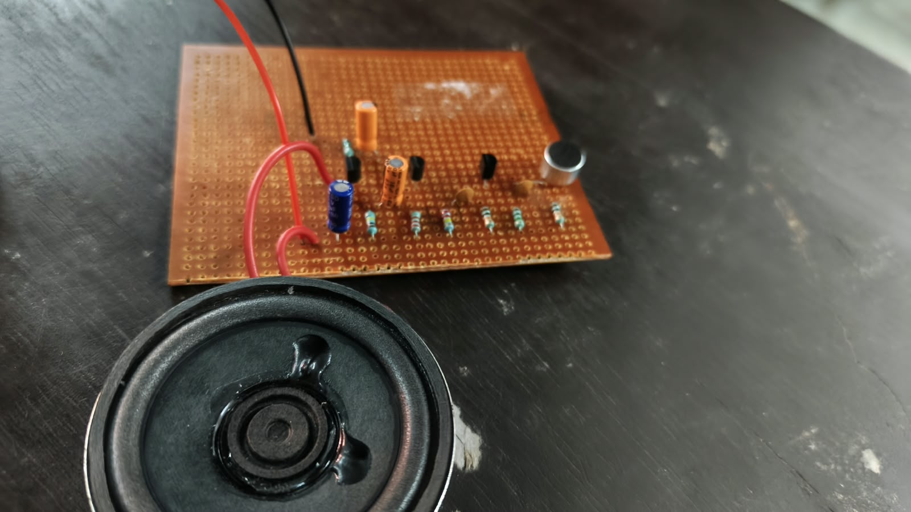
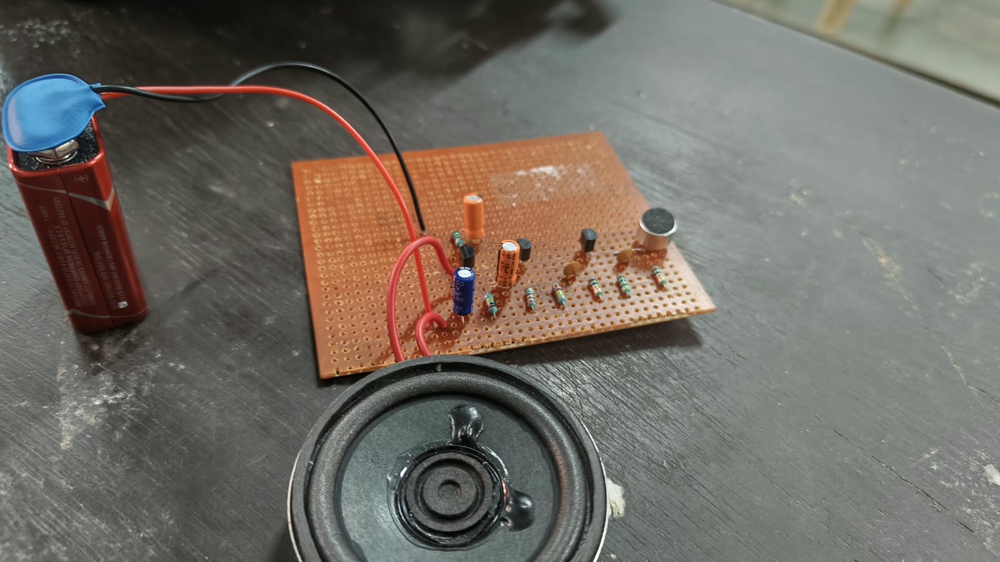
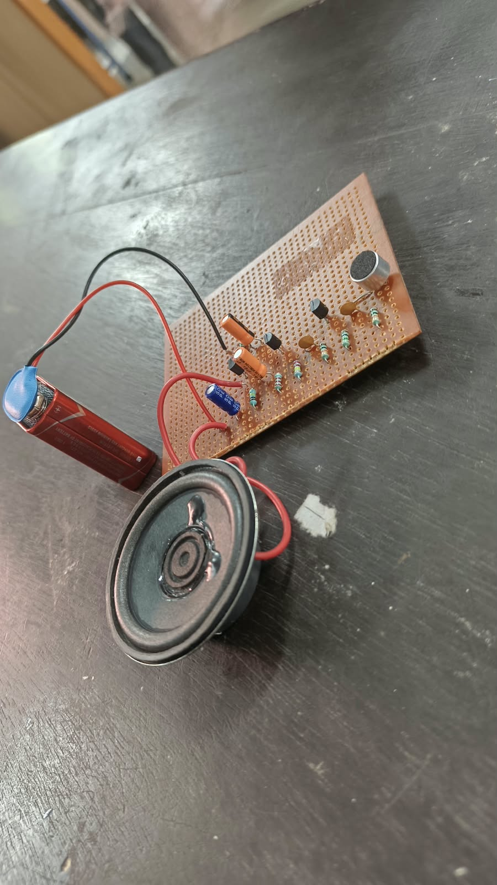

# Low-Cost Transistorised Intercom

A discrete-transistor analogue audio project built using BC548 and BEL187 transistors, an electret condenser microphone and an 8 Ω loudspeaker.

> **Project status:** A physical prototype was assembled and tested. The demonstrated result was **one-way audio reproduction through the speaker in the same unit**. The intended communication between two separate stations (two-way intercom operation) was **not achieved** during this build.

## Overview

The aim of this project is to explore a low-cost analogue voice/audio communication circuit using discrete transistor stages rather than a dedicated audio amplifier IC or microcontroller.

The supplied design uses a three-transistor signal chain:
- **T1 – BC548:** first small-signal voltage-amplifier stage.
- **T2 – BC548:** additional voltage-amplifier stage.
- **T3 – BEL187:** output stage intended to drive the loudspeaker.

An electret condenser microphone converts sound into a small electrical signal. The signal is coupled through the amplifier stages, and the output stage drives an 8 Ω speaker.

The original goal was to build two identical units and connect them for two-way communication. In the physical implementation documented here, audio was heard from the speaker associated with the same unit; communication between two separate stations was not demonstrated.

## Demonstrated result

- The circuit was physically assembled on perforated/veroboard.
- A 9 V battery was used as the supply.
- Audio picked up by the microphone was reproduced through the speaker in the same unit.
- A complete two-station, two-way intercom connection was not achieved.

This repository documents the actual prototype and its demonstrated result. It does not claim successful two-way communication or measured performance that was not verified.

## Main components

| Component | Specification | Quantity for two intended units |
|---|---|---:|
| BC548 transistor | NPN | 4 |
| BEL187 transistor | NPN | 2 |
| Resistors | 10 kΩ, 1 MΩ, 220 kΩ, 2.2 kΩ, 100 kΩ, 150 Ω | 14 total |
| Capacitors | 0.1 µF and 10 µF / 16 V electrolytic | 10 listed |
| Electret condenser microphone | Microphone capsule | 2 |
| Loudspeaker | 8 Ω | 2 |
| ON/OFF switch | SPST slide switch | 2 |
| Push-button | Momentary, push-to-on | 2 |
| DC supply | 9–12 V | 2 |
| Veroboard and wires | Assembly materials | As required |

**Component note:** The circuit drawing also labels C8 as 100 µF / 16 V. Confirm the required capacitor count and values against the final circuit before assembly.

## Working principle

1. The electret microphone converts sound into a low-level electrical audio signal.
2. The first BC548 stage amplifies the microphone signal.
3. The second BC548 stage provides further voltage amplification.
4. The BEL187 output stage provides the drive intended for the 8 Ω loudspeaker.
5. The loudspeaker converts the electrical audio signal back into sound.

Resistors establish the transistor operating points, while capacitors provide signal coupling, bypassing and supply decoupling as shown in the circuit.

## Prototype photographs

### Front view

### Prototype with 9 V battery

### Side view

### Close-up of the assembled board

## Limitations and future work

The intended two-way communication between two separate stations was not completed. Further work would include checking the microphone bias and polarity, transistor pinouts, resistor values, electrolytic-capacitor polarity, solder joints, supply and ground wiring, and the interconnection between the two units.

Future improvements may include completing and verifying the two-station audio paths, reducing hum and acoustic feedback, and measuring audio clarity, range and current consumption after the circuit is operating reliably.

## Project cost

**Reported project cost: ₹500.**

## Learning outcomes

This project provided practical experience with:
- Discrete BJT amplifier stages and transistor biasing.
- RC coupling and bypass capacitors.
- Electret microphone interfacing.
- Loudspeaker output stages.
- Veroboard construction, soldering and circuit fault isolation.

## Team

- Ameena Husna P — AM.EN.U4ECE25011
- Cia NS — AM.EN.U4ECE25021
- Gopika Gopakumar — AM.EN.U4ECE25028
- Gopika Prabha Sankar — AM.EN.U4ECE25029

**Department of Electronics and Communication Engineering**  
**Amrita Vishwa Vidyapeetham, Amritapuri**

---

*This repository records the prototype's actual build status. The one-way audio result described above should not be interpreted as a completed two-way intercom.*
