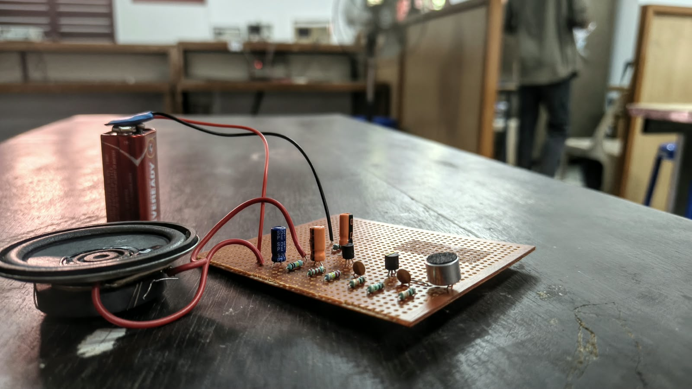

# Low-Cost Transistorised Intercom

A discrete-transistor analogue audio project built using BC548 and BEL187 transistors, an electret condenser microphone and an 8 Ω loudspeaker.

## Overview

The aim of this project is to explore a low-cost analogue voice/audio communication circuit using discrete transistor stages rather than a dedicated audio amplifier IC or microcontroller.

The supplied design uses a three-transistor signal chain:
- **T1 – BC548:** first small-signal voltage-amplifier stage.
- **T2 – BC548:** additional voltage-amplifier stage.
- **T3 – BEL187:** output stage intended to drive the loudspeaker.

An electret condenser microphone converts sound into a small electrical signal. The signal is coupled through the amplifier stages, and the output stage drives an 8 Ω speaker.

The original goal was to build two identical units and connect them for two-way communication. In the physical implementation documented here, audio was heard from the speaker associated with the same unit; communication between two separate stations was not demonstrated.

## Demonstrated result

- The circuit was physically assembled on perforated/veroboard.
- A 9 V battery was used as the supply.
- Audio picked up by the microphone was reproduced through the speaker in the same unit.

## Main components

| Component | Specification | Quantity  |
|---|---|---:|
| BC548 transistor | NPN | 2 |
| BEL187 transistor | NPN | 1 |
| Resistors | 10 kΩ, 1 MΩ, 220 kΩ, 2.2 kΩ, 100 kΩ, 150 Ω | 7 total |
| Capacitors | 0.1 µF and 10 µF / 16 V electrolytic | 5 listed |
| Electret condenser microphone | Microphone capsule | 1 |
| Loudspeaker | 8 Ω | 1 |
| DC supply | 9–12 V | 2 |
| Veroboard and wires | Assembly materials | As required |

## Working principle

1. The electret microphone converts sound into a low-level electrical audio signal.
2. The first BC548 stage amplifies the microphone signal.
3. The second BC548 stage provides further voltage amplification.
4. The BEL187 output stage provides the drive intended for the 8 Ω loudspeaker.
5. The loudspeaker converts the electrical audio signal back into sound.

Resistors establish the transistor operating points, while capacitors provide signal coupling, bypassing and supply decoupling as shown in the circuit.
## Circuit Diagram

## Prototype photographs

## Future work

Future improvements may include completing and verifying the two-station audio paths, reducing hum and acoustic feedback, and measuring audio clarity, range.

## Project cost

Project cost: ₹250

## Learning outcomes

This project provided practical experience with:
- Discrete BJT amplifier stages and transistor biasing.
- RC coupling and bypass capacitors.
- Electret microphone interfacing.
- Loudspeaker output stages.
- Veroboard construction, soldering and circuit fault isolation.

